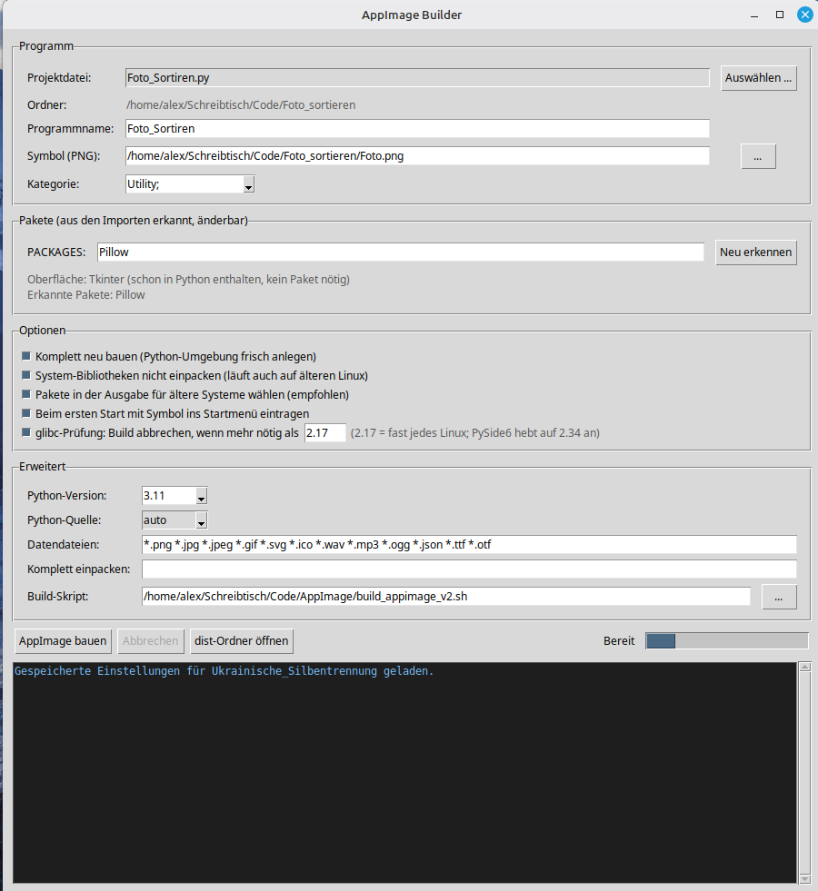

# AppImage Builder

[English](README.md) | **Deutsch**

**Python- und Rust-Programme mit wenigen Klicks in ein AppImage verwandeln – mit grafischer Oberfläche, automatischer Paketerkennung und Startmenü-Eintrag.**



Der AppImage Builder ist eine Oberfläche (Tkinter) für zwei Build-Skripte:

- `build_appimage_v2.sh` – für **Python-Programme** (Tkinter, PyQt5, PySide6 …)
- `build_appimage_rust.sh` – für **Rust-Programme** (Cargo)

Datei auswählen, Haken setzen, „AppImage bauen“ klicken – fertig ist eine einzelne Datei, die auf vielen Linux-Systemen ohne Installation läuft.

---

## Inhalt

- [Funktionen](#funktionen)
- [Voraussetzungen](#voraussetzungen)
- [Installation](#installation)
- [Benutzung – Python](#benutzung--python)
- [Benutzung – Rust](#benutzung--rust)
- [Alle Einstellungen erklärt](#alle-einstellungen-erklärt)
- [Was passiert beim Bauen?](#was-passiert-beim-bauen)
- [Kompatibilität (glibc)](#kompatibilität-glibc)
- [Startmenü und Symbol](#startmenü-und-symbol)
- [Sprachen](#sprachen)
- [Den Builder selbst als AppImage bauen](#den-builder-selbst-als-appimage-bauen)
- [Skripte ohne Oberfläche benutzen](#skripte-ohne-oberfläche-benutzen)
- [Testen auf älteren Systemen](#testen-auf-älteren-systemen)
- [Fehlerbehebung](#fehlerbehebung)
- [Dateien im Projekt](#dateien-im-projekt)
- [Lizenz](#lizenz)

---

## Funktionen

**Für Python-Programme**
- Hauptdatei (`.py` / `.pyw`) auswählen → Ordner, Programmname und Symbol werden automatisch übernommen
- **Automatische Paketerkennung:** Die Importe werden ausgewertet und die richtigen PyPI-Pakete eingetragen
  - Import-Namen werden in Paketnamen übersetzt, z. B. `PIL` → `Pillow`, `cv2` → `opencv-python`, `docx` → `python-docx`, `yaml` → `PyYAML`
  - Eigene Module und Pakete im Projektordner werden erkannt und verfolgt
  - Fremde `.py`-Dateien, die zufällig im selben Ordner liegen, werden **nicht** mitgezählt
  - Hinweise bei Windows-Modulen (`win32api`, `winreg` …) und problematischen Paketen
- Tkinter-Programme bekommen automatisch Python mit **geglätteter Schrift** (Tk mit Xft von conda-forge)
- Pakete werden gezielt in der Ausgabe **für ältere Linux-Systeme** installiert

**Für Rust-Programme**
- `Cargo.toml` auswählen → Programmname, Version und Beschreibung werden gelesen
- Die **APP_ID** wird direkt im Quelltext gesucht (z. B. `const APP_ID: &str = "…"`), damit das Fenster in der Leiste das richtige Symbol zeigt
- Symbol wird in `assets/` bzw. `src/assets/` gefunden
- Bau mit **cargo-zigbuild** für eine wählbare glibc-Version (z. B. 2.28 für Linux Mint 20)

**Für beide**
- Alle Optionen per Haken ein- und ausschalten
- **Live-Ausgabe** des Build-Vorgangs im Fenster, Abbrechen jederzeit möglich
- **Einstellungen werden pro Projekt gespeichert** – beim nächsten Mal ist alles wieder so eingestellt
- Fertige AppImages **tragen sich beim ersten Start selbst ins Startmenü ein** – mit Symbol, auch im Dateimanager
- Prüfung der benötigten **glibc-Version** am Ende jedes Builds
- Der Builder kann **sich selbst als AppImage bauen**
- Oberfläche in **21 Sprachen**, weitere als JSON-Datei ergänzbar

---

## Voraussetzungen

| Was | Wofür | Installation |
|---|---|---|
| Linux **x86_64** | Bau-Rechner | – |
| Python 3 mit Tkinter | Oberfläche | `sudo apt install python3-tk` |
| `bash`, `curl` | Build-Skripte | meist schon vorhanden |
| **uv** | Python-Programme bauen | `curl -LsSf https://astral.sh/uv/install.sh \| sh` |
| **Rust / cargo** | Rust-Programme bauen | siehe [rustup.rs](https://rustup.rs) |
| **cargo-zigbuild** *(empfohlen)* | Rust für ältere glibc bauen | `cargo install cargo-zigbuild && pip install ziglang` |

Beim ersten Build werden automatisch heruntergeladen (einmalig, danach zwischengespeichert):
- `appimagetool`
- bei Tkinter-Programmen: `micromamba` und Python + Tk von conda-forge

---

## Installation

```bash
git clone https://github.com/epp-alex/AppImage-Builder.git
cd AppImage-Builder
python3 AppImage_Builder.py
```

Wichtig: `AppImage_Builder.py`, `build_appimage_v2.sh` und `build_appimage_rust.sh` müssen **im selben Ordner** liegen.

Alternativ das fertige `AppImage_Builder.AppImage` aus den [Releases](../../releases) herunterladen, ausführbar machen und starten:

```bash
chmod +x AppImage_Builder.AppImage
./AppImage_Builder.AppImage
```

---

## Benutzung – Python

1. **„Auswählen …“** klicken und die **Hauptdatei** deines Programms wählen (z. B. `MeinProgramm.py`).
2. Der Builder trägt automatisch ein:
   - **Programmname** = Dateiname ohne `.py`
   - **Symbol** = `MeinProgramm.png`, sonst `icon.png`, sonst das erste PNG im Ordner
   - **PACKAGES** = die erkannten Pakete
3. Erkennung prüfen (unter dem Feld steht, was gefunden wurde) und bei Bedarf anpassen.
4. Kategorie und Optionen wählen.
5. **„AppImage bauen“** klicken.

Ergebnis:
```
<Projektordner>/dist/<Programmname>-x86_64.AppImage
```

> **Tipp:** Jedes Programm in einen **eigenen Ordner** legen. Das Build-Skript packt alle Bilder, Töne und Datendateien aus dem Ordner (und Unterordnern mit solchen Dateien) mit ein.

### Beispiele für die Erkennung

| Programm importiert … | PACKAGES |
|---|---|
| `tkinter`, `chardet` | `chardet` |
| `tkinter`, `docx` | `python-docx` |
| `tkinter`, `PIL` | `Pillow` |
| `PySide6`, `numpy`, `cv2`, `yaml` | `PySide6 numpy opencv-python PyYAML` |
| nur Standardbibliothek + `tkinter` | *(leer)* |

---

## Benutzung – Rust

1. **„Auswählen …“** klicken und die **`Cargo.toml`** des Projekts wählen.
2. Der Builder schaltet in den **Rust-Modus** und trägt ein:
   - Programmname aus `[[bin]]` bzw. `[package]`
   - Version und Beschreibung aus `[package]`
   - **Kennung (APP_ID)** aus dem Quelltext
   - Symbol aus `assets/` oder `src/assets/`
3. **Älteste glibc** wählen (Standard: 2.28 → ab Linux Mint 20 / Ubuntu 20.04 / Debian 10).
4. **„AppImage bauen“** klicken.

Ergebnis:
```
<Projektordner>/dist/<Programm>-<Version>-x86_64.AppImage
```

> **Wichtig:** Die APP_ID muss zu der Kennung passen, die dein Programm seinem Fenster gibt. Nur dann zeigt die Leiste das Symbol aus dem Startmenü-Eintrag (`StartupWMClass`).

---

## Alle Einstellungen erklärt

### Programm (beide Modi)

| Feld | Bedeutung |
|---|---|
| Projektdatei | Python-Hauptdatei oder `Cargo.toml` |
| Programmname | Name des AppImage und des Startmenü-Eintrags |
| Symbol (PNG) | Programmsymbol, am besten 256×256 oder größer |
| Kategorie | Startmenü-Rubrik (`Utility;`, `Education;`, `Game;`, `Office;`, `Development;` …) |

### Python – Optionen

| Option | Bedeutung |
|---|---|
| Komplett neu bauen | Python-Umgebung (`.venv`) jedes Mal frisch anlegen – verhindert Reste alter Builds |
| System-Bibliotheken nicht einpacken | GTK, X11, GLib usw. des Bau-Rechners weglassen → läuft auch auf älteren Systemen |
| Pakete für ältere Systeme wählen | installiert nur fertige Pakete für `manylinux_2_17` (PySide6: `manylinux_2_34`), nie selbst kompiliert |
| Beim ersten Start ins Startmenü eintragen | siehe [Startmenü und Symbol](#startmenü-und-symbol) |
| glibc-Prüfung | Build schlägt fehl, wenn das AppImage eine neuere glibc braucht als angegeben. Bei PySide6 wird die Grenze automatisch auf 2.34 angehoben |

### Python – Erweitert

| Feld | Bedeutung |
|---|---|
| Python-Version | z. B. `3.11` |
| Python-Quelle | `auto` = conda-forge bei Tkinter (schöne Schrift), sonst uv · `conda` · `uv` |
| Datendateien | Dateitypen, die mit eingepackt werden (`*.png *.wav *.json …`) |
| Komplett einpacken | Python-Module, die PyInstaller vollständig einpacken soll, weil sie Teile erst beim Start laden (`pynput` wird automatisch erkannt) |
| Build-Skript | Pfad zu `build_appimage_v2.sh` |

### Rust

| Feld | Bedeutung |
|---|---|
| Kennung (APP_ID) | Fenster-Kennung des Programms |
| Beschreibung | Text im Startmenü (`Comment=`) |
| Älteste glibc | Ziel-glibc für cargo-zigbuild |
| Startmenü-Eintrag | ein-/ausschalten |
| Rust-Build-Skript | Pfad zu `build_appimage_rust.sh` |

---

## Was passiert beim Bauen?

### Python
1. Python-Umgebung anlegen – bei Tkinter mit Python + Tk (Xft) von conda-forge
2. Pakete mit `uv` installieren – nur fertige Pakete für die Zielplattform
3. Programm mit **PyInstaller** bauen, Bilder/Daten und Tcl/Tk einpacken
4. System-Bibliotheken des Bau-Rechners entfernen
5. AppDir mit Startskript (`AppRun`), `.desktop`-Datei und Symbol zusammenstellen
6. AppImage mit **appimagetool** erzeugen
7. Benötigte glibc-Version prüfen und anzeigen

### Rust
1. Werte aus `Cargo.toml` lesen
2. Mit **cargo-zigbuild** für die gewählte glibc kompilieren (ohne zigbuild: normaler `cargo build` mit Warnung)
3. AppDir mit Startskript, `.desktop`-Datei und Symbol zusammenstellen
4. AppImage mit appimagetool erzeugen

---

## Kompatibilität (glibc)

Ein Linux-Programm läuft nur auf Systemen, deren **glibc mindestens so neu** ist wie die, für die es gebaut wurde. Am Ende jedes Builds steht:

```
Benötigt mindestens: glibc 2.17
```

| System | glibc | Python (Tkinter/PyQt5) | Python (PySide6) | Rust (2.28) |
|---|---|---|---|---|
| Linux Mint 22 / Ubuntu 24.04 | 2.39 | ✔ | ✔ | ✔ |
| Linux Mint 21 / Ubuntu 22.04 | 2.35 | ✔ | ✔ | ✔ |
| Linux Mint 20 / Ubuntu 20.04 | 2.31 | ✔ | ✘ | ✔ |
| Debian 12 / 11 / 10 | 2.36 / 2.31 / 2.28 | ✔ | nur 12 | ✔ |
| Linux Mint 19 / Ubuntu 18.04 | 2.27 | ✔ | ✘ | ✘ (mit 2.17: ✔) |
| CentOS 7 | 2.17 | ✔ | ✘ | ✘ (mit 2.17: ✔) |

PySide6 gibt es nicht für glibc älter als 2.34 – daran lässt sich beim Bauen nichts ändern.

---

## Startmenü und Symbol

Ein Linux-Programm (ELF-Datei) kann – anders als eine Windows-`.exe` – **kein eingebautes Symbol** haben. Damit AppImages trotzdem gut aussehen, enthält jedes erzeugte AppImage ein Startskript, das sich beim Start selbst einbindet:

- **beim ersten Start:** Startmenü-Eintrag und Symbol werden angelegt, die Datei bekommt ihr Symbol im Dateimanager
- **bei jedem weiteren Start:** nichts – der Eintrag existiert schon
- **nach dem Verschieben:** der Eintrag wird beim nächsten Start auf den neuen Ort aktualisiert

Angelegt wird:
```
~/.local/share/applications/appimage-<Name>.desktop
~/.local/share/icons/appimage-<Name>.png
```

Das Symbol im Dateimanager erscheint erst nach dem ersten Start – eventuell **F5** drücken oder Nemo neu starten (`nemo -q`).

**Abschalten:** Haken „Beim ersten Start … eintragen“ entfernen, oder einmalig beim Start:
```bash
APPIMAGE_NO_INTEGRATE=1 ./Programm-x86_64.AppImage
```

**Entfernen:** die beiden oben genannten Dateien löschen.

---

## Sprachen

Die Oberfläche gibt es in **21 Sprachen**:

| | | | |
|---|---|---|---|
| Čeština (cs) | Dansk (da) | Deutsch (de) | Eesti (et) |
| English (en) | Español (es) | Français (fr) | Italiano (it) |
| Magyar (hu) | Nederlands (nl) | Norsk bokmål (nb) | Polski (pl) |
| Português (pt) | Română (ro) | Slovenčina (sk) | Suomi (fi) |
| Svenska (sv) | Türkçe (tr) | Ελληνικά (el) | Русский (ru) |
| Українська (uk) | | | |

Deutsch und Englisch sind im Programm eingebaut, alle anderen liegen als JSON-Datei im Ordner `lang/`. Beim ersten Start wird die Systemsprache genommen; oben rechts kann jederzeit umgeschaltet werden – ohne Neustart, alle Eingaben bleiben erhalten. Die Wahl wird gespeichert.

Die Ausgabe der Build-Skripte ist auf Deutsch.

### Weitere Sprache hinzufügen

Ohne den Code zu ändern:

1. Vorlage erzeugen (Englisch als Grundlage):
   ```bash
   python3 AppImage_Builder.py --export-lang en > lang/es.json
   ```
   oder `lang/_vorlage_en.json` kopieren und umbenennen.
2. In der Datei `"_name"` auf den Namen der Sprache setzen (z. B. `"Español"`) und die Texte übersetzen. Platzhalter wie `{name}` oder `{path}` unverändert lassen.
3. Programm neu starten – die Sprache erscheint in der Auswahl.

Der Dateiname ist der Sprachcode (`es.json`, `fr.json`, `uk.json` …). Fehlende Texte werden automatisch auf Englisch angezeigt, eine Übersetzung kann also auch nach und nach entstehen.

Gesucht wird in:
- `lang/` neben `AppImage_Builder.py` (bzw. im AppImage eingepackt)
- `~/.config/AppImageBuilder/lang/`

Übersetzungen sind als Pull Request willkommen!

---

## Den Builder selbst als AppImage bauen

1. Diese Dateien in einen **eigenen, leeren Ordner** legen:
   ```
   AppImage_Builder.py
   AppImage_Builder.png
   build_appimage_v2.sh
   build_appimage_rust.sh
   lang/          (Sprachdateien)
   ```
2. `python3 AppImage_Builder.py` starten und `AppImage_Builder.py` selbst auswählen.
3. Unter **Erweitert → Datendateien** am Ende ` *.sh` anhängen (damit die Build-Skripte mit hineinkommen). Der Ordner `lang/` kommt automatisch mit, weil `*.json` schon in der Liste steht.
4. „Komplett einpacken“ bleibt leer, „Build-Skript“ bleibt `build_appimage_v2.sh`.
5. **„AppImage bauen“**.

Als AppImage findet der Builder seine eingebauten Skripte selbst und gibt den Build-Programmen eine bereinigte Umgebung mit (ohne die AppImage-Variablen), damit `uv`, `cargo` und `appimagetool` nicht versehentlich seine Bibliotheken laden.

Eine Datei kann direkt beim Start übergeben werden:
```bash
./AppImage_Builder.AppImage ~/Projekte/MeinProgramm/MeinProgramm.py
```

---

## Skripte ohne Oberfläche benutzen

Beide Skripte funktionieren auch allein. Entweder die Einstellungen oben im Skript ändern und im Projektordner starten:

```bash
bash build_appimage_v2.sh            # Python
bash build_appimage_v2.sh --clean    # Python, komplett neu
bash build_appimage_rust.sh          # Rust
```

oder Einstellungen von außen übergeben:

```bash
PROJECT_DIR=~/Projekte/Pyt APP_NAME=Pyt MAIN_SCRIPT=Pyt.py \
ICON=~/Projekte/Pyt/Pyt.png PACKAGES="chardet" \
bash build_appimage_v2.sh
```

```bash
PROJECT_DIR=~/Projekte/Silben APP_NAME=De_Silben APP_ID=de_syllable_hyphenator \
COMMENT="Silbentrennung" GLIBC=2.28 \
bash build_appimage_rust.sh
```

---

## Testen auf älteren Systemen

Am zuverlässigsten in einer virtuellen Maschine (VirtualBox, VMware), z. B. mit **Linux Mint 20** und **21**:

- Python-Programme mit Tkinter/PyQt5 → in Mint 20 testen (läuft es dort, läuft es auch auf neueren)
- PySide6-Programme → in Mint 21 testen
- Nach der Installation einen **Snapshot** anlegen, damit jeder Test auf einem sauberen System läuft
- Zum Testen im Terminal starten – dann sieht man Fehlermeldungen

Mehrfach-Starttest (124 = lief, 139 = Absturz):
```bash
for i in $(seq 10); do timeout 3 ./Programm-x86_64.AppImage >/dev/null 2>&1; echo "Start $i: $?"; done
```

---

## Fehlerbehebung

| Problem | Ursache / Lösung |
|---|---|
| AppImage startet nicht, Hinweis auf FUSE | `sudo apt install libfuse2` oder `./Programm.AppImage --appimage-extract-and-run` |
| Kein Symbol im Dateimanager | AppImage einmal starten, dann F5 bzw. `nemo -q` |
| `ModuleNotFoundError` beim Start | Paket fehlt in PACKAGES → eintragen und neu bauen |
| Programm startet als AppImage nicht, ohne Meldung | im Terminal starten, um den Fehler zu sehen |
| `Segmentation fault` bei Tkinter auf älteren Systemen (z. B. Mint 21) | ein farbiges **Emoji in der Oberfläche beim Start** kann mit dem eingepackten Tk abstürzen → Emoji entfernen |
| Datei-Dialog öffnet sich in einem Temp-Ordner (`/tmp/.mount_…`) | im Programm `initialdir=` für `filedialog` angeben (z. B. Home-Ordner) |
| Build bricht bei der glibc-Prüfung ab | ein Paket braucht eine neuere glibc → Grenze anheben oder Paket ersetzen |
| Rust-AppImage läuft nicht auf älteren Systemen | `cargo-zigbuild` installieren, sonst wirkt die glibc-Einstellung nicht |
| Fertiges AppImage nicht gefunden | es liegt immer im Ordner **`dist`** und endet auf `.AppImage` |

---

## Dateien im Projekt

| Datei | Beschreibung |
|---|---|
| `AppImage_Builder.py` | grafische Oberfläche |
| `AppImage_Builder.png` | Programmsymbol |
| `build_appimage_v2.sh` | Build-Skript für Python-Programme |
| `build_appimage_rust.sh` | Build-Skript für Rust-Programme |
| `lang/` | Sprachdateien (`<code>.json`), Vorlage `_vorlage_en.json` |

Gespeicherte Einstellungen:
```
~/.config/AppImageBuilder/einstellungen.json
```

Im Projektordner des gebauten Programms entstehen:
```
.venv/     Python-Umgebung (nur Python)
build/     Zwischendateien, appimagetool, conda-Python
dist/      fertiges AppImage
```

---

## Lizenz

Dieses Projekt steht unter der **MIT-Lizenz** – siehe [LICENSE](LICENSE).
