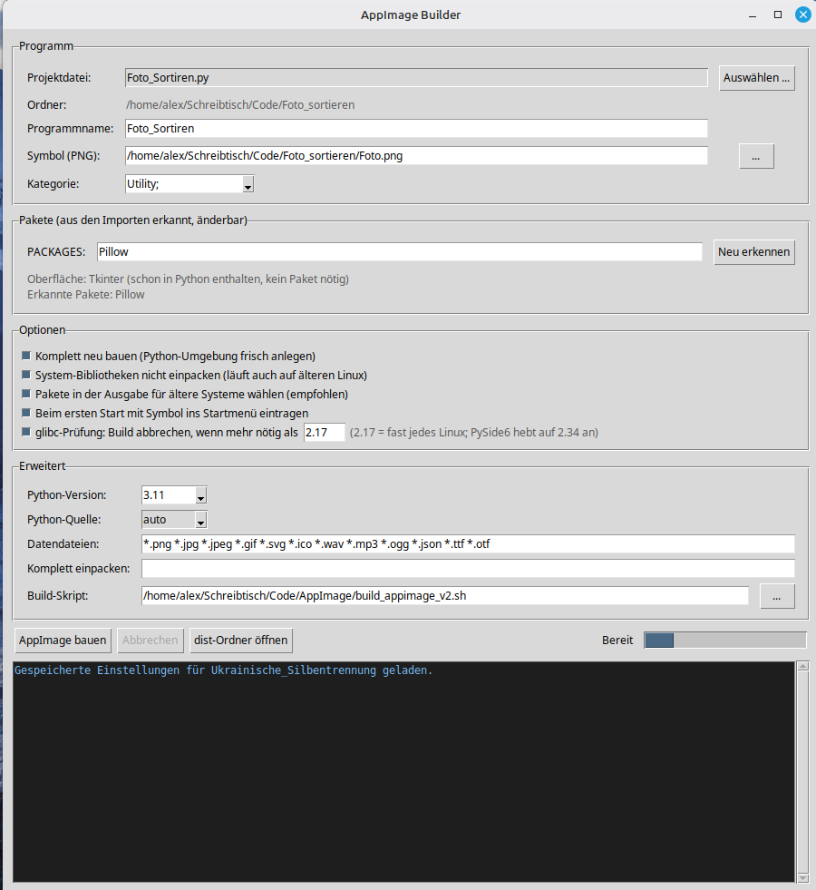

# AppImage Builder

**English** | [Deutsch](README.de.md)

**Turn Python and Rust programs into an AppImage in a few clicks – with a graphical interface, automatic package detection and an application menu entry.**



AppImage Builder is a graphical front end (Tkinter) for two build scripts:

- `build_appimage_v2.sh` – for **Python programs** (Tkinter, PyQt5, PySide6 …)
- `build_appimage_rust.sh` – for **Rust programs** (Cargo)

Pick a file, tick a few boxes, click "Build AppImage" – and you get a single file that runs on many Linux systems without installation.

---

## Contents

- [Features](#features)
- [Requirements](#requirements)
- [Installation](#installation)
- [Usage – Python](#usage--python)
- [Usage – Rust](#usage--rust)
- [All settings explained](#all-settings-explained)
- [What happens during a build?](#what-happens-during-a-build)
- [Compatibility (glibc)](#compatibility-glibc)
- [Application menu and icon](#application-menu-and-icon)
- [Languages](#languages)
- [Building the builder itself as an AppImage](#building-the-builder-itself-as-an-appimage)
- [Using the scripts without the GUI](#using-the-scripts-without-the-gui)
- [Testing on older systems](#testing-on-older-systems)
- [Troubleshooting](#troubleshooting)
- [Project files](#project-files)
- [License](#license)

---

## Features

**For Python programs**
- Choose the main file (`.py` / `.pyw`) → folder, program name and icon are filled in automatically
- **Automatic package detection:** imports are analysed and the correct PyPI packages are entered
  - Import names are translated into package names, e.g. `PIL` → `Pillow`, `cv2` → `opencv-python`, `docx` → `python-docx`, `yaml` → `PyYAML`
  - Your own modules and packages in the project folder are detected and followed
  - Unrelated `.py` files that happen to be in the same folder are **not** counted
  - Notes for Windows-only modules (`win32api`, `winreg` …) and problematic packages
- Tkinter programs automatically get Python with **smooth (anti-aliased) fonts** (Tk with Xft from conda-forge)
- Packages are installed in the variant built **for older Linux systems**

**For Rust programs**
- Choose `Cargo.toml` → program name, version and description are read
- The **APP_ID** is looked up directly in the source code (e.g. `const APP_ID: &str = "…"`), so the window shows the right icon in the panel
- The icon is found in `assets/` or `src/assets/`
- Builds with **cargo-zigbuild** for a selectable glibc version (e.g. 2.28 for Linux Mint 20)

**For both**
- Every option can be switched on and off with a checkbox
- **Live output** of the build in the window, cancel at any time
- **Settings are saved per project** – next time everything is set up the same way
- Finished AppImages **add themselves to the application menu on first start** – with icon, also in the file manager
- Check of the required **glibc version** at the end of every build
- The builder can **build itself as an AppImage**
- Interface in **21 languages**, more can be added as JSON files

---

## Requirements

| What | For | Installation |
|---|---|---|
| Linux **x86_64** | build machine | – |
| Python 3 with Tkinter | the GUI | `sudo apt install python3-tk` |
| `bash`, `curl` | build scripts | usually already installed |
| **uv** | building Python programs | `curl -LsSf https://astral.sh/uv/install.sh \| sh` |
| **Rust / cargo** | building Rust programs | see [rustup.rs](https://rustup.rs) |
| **cargo-zigbuild** *(recommended)* | Rust builds for older glibc | `cargo install cargo-zigbuild && pip install ziglang` |

Downloaded automatically on the first build (once, then cached):
- `appimagetool`
- for Tkinter programs: `micromamba` and Python + Tk from conda-forge

---

## Installation

```bash
git clone https://github.com/epp-alex/AppImage-Builder.git
cd AppImage-Builder
python3 AppImage_Builder.py
```

Important: `AppImage_Builder.py`, `build_appimage_v2.sh` and `build_appimage_rust.sh` must be **in the same folder**.

Or download the ready-made `AppImage_Builder.AppImage` from the [Releases](../../releases), make it executable and start it:

```bash
chmod +x AppImage_Builder.AppImage
./AppImage_Builder.AppImage
```

---

## Usage – Python

1. Click **"Choose …"** and select the **main file** of your program (e.g. `MyProgram.py`).
2. The builder fills in automatically:
   - **Program name** = file name without `.py`
   - **Icon** = `MyProgram.png`, otherwise `icon.png`, otherwise the first PNG in the folder
   - **PACKAGES** = the detected packages
3. Check the detection (shown below the field) and adjust if needed.
4. Choose category and options.
5. Click **"Build AppImage"**.

Result:
```
<project folder>/dist/<program name>-x86_64.AppImage
```

> **Tip:** Put every program in its **own folder**. The build script bundles all images, sounds and data files from the folder (and from subfolders containing such files).

### Detection examples

| Program imports … | PACKAGES |
|---|---|
| `tkinter`, `chardet` | `chardet` |
| `tkinter`, `docx` | `python-docx` |
| `tkinter`, `PIL` | `Pillow` |
| `PySide6`, `numpy`, `cv2`, `yaml` | `PySide6 numpy opencv-python PyYAML` |
| standard library only + `tkinter` | *(empty)* |

---

## Usage – Rust

1. Click **"Choose …"** and select the project's **`Cargo.toml`**.
2. The builder switches to **Rust mode** and fills in:
   - program name from `[[bin]]` or `[package]`
   - version and description from `[package]`
   - **identifier (APP_ID)** from the source code
   - icon from `assets/` or `src/assets/`
3. Choose the **oldest glibc** (default: 2.28 → Linux Mint 20 / Ubuntu 20.04 / Debian 10 and newer).
4. Click **"Build AppImage"**.

Result:
```
<project folder>/dist/<program>-<version>-x86_64.AppImage
```

> **Important:** The APP_ID must match the identifier your program gives its window. Only then does the panel show the icon from the menu entry (`StartupWMClass`).

---

## All settings explained

### Program (both modes)

| Field | Meaning |
|---|---|
| Project file | Python main file or `Cargo.toml` |
| Program name | name of the AppImage and of the menu entry |
| Icon (PNG) | program icon, ideally 256×256 or larger |
| Category | menu category (`Utility;`, `Education;`, `Game;`, `Office;`, `Development;` …) |

### Python – Options

| Option | Meaning |
|---|---|
| Clean build | create the Python environment (`.venv`) from scratch every time – avoids leftovers from older builds |
| Do not bundle system libraries | leave out GTK, X11, GLib etc. of the build machine → also runs on older systems |
| Install packages for older systems | only installs ready-made packages for `manylinux_2_17` (PySide6: `manylinux_2_34`), never compiles locally |
| Add to the application menu on first start | see [Application menu and icon](#application-menu-and-icon) |
| glibc check | the build fails if the AppImage needs a newer glibc than given. For PySide6 the limit is raised to 2.34 automatically |

### Python – Advanced

| Field | Meaning |
|---|---|
| Python version | e.g. `3.11` |
| Python source | `auto` = conda-forge for Tkinter (nice fonts), otherwise uv · `conda` · `uv` |
| Data files | file types that are bundled (`*.png *.wav *.json …`) |
| Collect completely | Python modules PyInstaller should bundle completely because they load parts at runtime (`pynput` is detected automatically) |
| Build script | path to `build_appimage_v2.sh` |

### Rust

| Field | Meaning |
|---|---|
| Identifier (APP_ID) | window identifier of the program |
| Description | text in the application menu (`Comment=`) |
| Oldest glibc | target glibc for cargo-zigbuild |
| Menu entry | on / off |
| Rust build script | path to `build_appimage_rust.sh` |

---

## What happens during a build?

### Python
1. Create the Python environment – for Tkinter with Python + Tk (Xft) from conda-forge
2. Install packages with `uv` – only ready-made packages for the target platform
3. Build the program with **PyInstaller**, bundle images/data and Tcl/Tk
4. Remove the build machine's system libraries
5. Assemble the AppDir with start script (`AppRun`), `.desktop` file and icon
6. Create the AppImage with **appimagetool**
7. Check and show the required glibc version

### Rust
1. Read values from `Cargo.toml`
2. Compile with **cargo-zigbuild** for the selected glibc (without zigbuild: normal `cargo build` with a warning)
3. Assemble the AppDir with start script, `.desktop` file and icon
4. Create the AppImage with appimagetool

---

## Compatibility (glibc)

A Linux program only runs on systems whose **glibc is at least as new** as the one it was built for. At the end of every build you see:

```
Benötigt mindestens: glibc 2.17
```
("requires at least glibc 2.17")

| System | glibc | Python (Tkinter/PyQt5) | Python (PySide6) | Rust (2.28) |
|---|---|---|---|---|
| Linux Mint 22 / Ubuntu 24.04 | 2.39 | ✔ | ✔ | ✔ |
| Linux Mint 21 / Ubuntu 22.04 | 2.35 | ✔ | ✔ | ✔ |
| Linux Mint 20 / Ubuntu 20.04 | 2.31 | ✔ | ✘ | ✔ |
| Debian 12 / 11 / 10 | 2.36 / 2.31 / 2.28 | ✔ | only 12 | ✔ |
| Linux Mint 19 / Ubuntu 18.04 | 2.27 | ✔ | ✘ | ✘ (with 2.17: ✔) |
| CentOS 7 | 2.17 | ✔ | ✘ | ✘ (with 2.17: ✔) |

PySide6 is not available for glibc older than 2.34 – this cannot be changed at build time.

---

## Application menu and icon

Unlike a Windows `.exe`, a Linux program (ELF file) **cannot contain an icon**. So that AppImages still look good, every AppImage created contains a start script that integrates it on start:

- **first start:** menu entry and icon are created, and the file gets its icon in the file manager
- **every further start:** nothing – the entry already exists
- **after moving the file:** the entry is updated to the new location on the next start

Created files:
```
~/.local/share/applications/appimage-<Name>.desktop
~/.local/share/icons/appimage-<Name>.png
```

The icon in the file manager appears only after the first start – press **F5** or restart Nemo (`nemo -q`) if needed.

**Turn off:** untick "Add to the application menu … on first start", or once at start:
```bash
APPIMAGE_NO_INTEGRATE=1 ./Program-x86_64.AppImage
```

**Remove:** delete the two files listed above.

---

## Languages

The interface is available in **21 languages**:

| | | | |
|---|---|---|---|
| Čeština (cs) | Dansk (da) | Deutsch (de) | Eesti (et) |
| English (en) | Español (es) | Français (fr) | Italiano (it) |
| Magyar (hu) | Nederlands (nl) | Norsk bokmål (nb) | Polski (pl) |
| Português (pt) | Română (ro) | Slovenčina (sk) | Suomi (fi) |
| Svenska (sv) | Türkçe (tr) | Ελληνικά (el) | Русский (ru) |
| Українська (uk) | | | |

German and English are built into the program, all others are JSON files in the `lang/` folder. On first start the system language is used; you can switch at any time in the top right corner – no restart needed, all input is kept. The choice is saved.

The output of the build scripts is in German.

### Adding a language

No code changes needed:

1. Create a template (English as the base):
   ```bash
   python3 AppImage_Builder.py --export-lang en > lang/xx.json
   ```
   or copy `lang/_vorlage_en.json` and rename it.
2. Set `"_name"` to the name of the language in that language (e.g. `"Español"`) and translate the texts. Keep placeholders like `{name}` or `{path}` unchanged.
3. Restart the program – the language appears in the list.

The file name is the language code (`es.json`, `fr.json`, `uk.json` …). Missing texts are shown in English automatically, so a translation can also grow step by step.

Language files are loaded from:
- `lang/` next to `AppImage_Builder.py` (or bundled inside the AppImage)
- `~/.config/AppImageBuilder/lang/`

Translations and corrections are welcome as pull requests!

---

## Building the builder itself as an AppImage

1. Put these files into their **own, empty folder**:
   ```
   AppImage_Builder.py
   AppImage_Builder.png
   build_appimage_v2.sh
   build_appimage_rust.sh
   lang/          (language files)
   ```
2. Start `python3 AppImage_Builder.py` and choose `AppImage_Builder.py` itself.
3. Under **Advanced → Data files** append ` *.sh` at the end (so the build scripts are bundled). The `lang/` folder is included automatically because `*.json` is already in the list.
4. Leave "Collect completely" empty; "Build script" stays `build_appimage_v2.sh`.
5. **"Build AppImage"**.

As an AppImage, the builder finds its bundled scripts by itself and gives the build tools a cleaned environment (without the AppImage variables), so that `uv`, `cargo` and `appimagetool` don't accidentally load its libraries.

A file can be passed directly at start:
```bash
./AppImage_Builder.AppImage ~/Projects/MyProgram/MyProgram.py
```

---

## Using the scripts without the GUI

Both scripts also work on their own. Either change the settings at the top of the script and run it in the project folder:

```bash
bash build_appimage_v2.sh            # Python
bash build_appimage_v2.sh --clean    # Python, clean build
bash build_appimage_rust.sh          # Rust
```

or pass settings from outside:

```bash
PROJECT_DIR=~/Projects/Pyt APP_NAME=Pyt MAIN_SCRIPT=Pyt.py \
ICON=~/Projects/Pyt/Pyt.png PACKAGES="chardet" \
bash build_appimage_v2.sh
```

```bash
PROJECT_DIR=~/Projects/Silben APP_NAME=De_Silben APP_ID=de_syllable_hyphenator \
COMMENT="Syllable hyphenation" GLIBC=2.28 \
bash build_appimage_rust.sh
```

---

## Testing on older systems

Most reliable in a virtual machine (VirtualBox, VMware), e.g. with **Linux Mint 20** and **21**:

- Python programs with Tkinter/PyQt5 → test on Mint 20 (if it runs there, it runs on newer ones too)
- PySide6 programs → test on Mint 21
- Take a **snapshot** after installation so every test runs on a clean system
- Start from a terminal when testing – then you see error messages

Repeated start test (124 = ran, 139 = crash):
```bash
for i in $(seq 10); do timeout 3 ./Program-x86_64.AppImage >/dev/null 2>&1; echo "Start $i: $?"; done
```

---

## Troubleshooting

| Problem | Cause / solution |
|---|---|
| AppImage does not start, message about FUSE | `sudo apt install libfuse2` or `./Program.AppImage --appimage-extract-and-run` |
| No icon in the file manager | start the AppImage once, then F5 or `nemo -q` |
| `ModuleNotFoundError` at start | package missing in PACKAGES → add it and rebuild |
| Program does not start as AppImage, no message | start it from a terminal to see the error |
| `Segmentation fault` with Tkinter on older systems (e.g. Mint 21) | a colour **emoji in the interface at start** can crash the bundled Tk → remove the emoji |
| File dialog opens in a temp folder (`/tmp/.mount_…`) | set `initialdir=` for `filedialog` in your program (e.g. the home folder) |
| Build stops at the glibc check | a package needs a newer glibc → raise the limit or replace the package |
| Rust AppImage does not run on older systems | install `cargo-zigbuild`, otherwise the glibc setting has no effect |
| Can't find the finished AppImage | it is always in the **`dist`** folder and ends with `.AppImage` |

---

## Project files

| File | Description |
|---|---|
| `AppImage_Builder.py` | graphical interface |
| `AppImage_Builder.png` | program icon |
| `build_appimage_v2.sh` | build script for Python programs |
| `build_appimage_rust.sh` | build script for Rust programs |
| `lang/` | language files (`<code>.json`), template `_vorlage_en.json` |

Saved settings:
```
~/.config/AppImageBuilder/einstellungen.json
```

Created in the project folder of the built program:
```
.venv/     Python environment (Python only)
build/     intermediate files, appimagetool, conda Python
dist/      finished AppImage
```

---

## License

This project is licensed under the **MIT License** – see [LICENSE](LICENSE).
